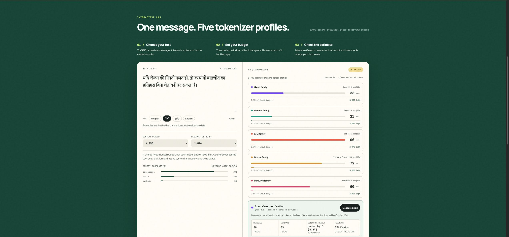

<h1 align="center">ContextFair</h1>

**Compare token estimates, reserve room for a reply, and check the result against a pinned Qwen tokenizer.**

[Open the public demo](https://contextfair.om-exp99.chatgpt.site) · [Demo script](docs/DEMO_SCRIPT.md) · [Devpost description](docs/DEVPOST_DRAFT.md)

Runs in a normal modern browser—no sign-in, Codex browser, API key, or installation required for the hosted demo. Entered text is processed locally; fonts, libraries, and tokenizer files load from external hosts.

By Om Patnaik · EurekaDev 2026 · Coding Track · Computer Science + AI.

[](LICENSE)



## Run locally

Requirements: Git, Python 3, and a modern browser supporting JavaScript modules and Web Workers. No package installation or build step is needed.

```bash
git clone https://github.com/OmTheLast/contextfair.git
cd contextfair
python3 -m http.server 4173 --bind 127.0.0.1 --directory dist
```

Open [http://127.0.0.1:4173](http://127.0.0.1:4173/). Serve over HTTP rather than opening the HTML file directly. First-time exact counting needs internet access and downloads about 19 MB of tokenizer assets plus library code—not AI model weights.

## Why

An inaccurate token estimate can affect how much conversation history an app keeps. ContextFair connects five quick estimates, a shared context budget, and one exact Qwen measurement. It does not prune history or measure complete provider chat prompts.

## Try the one-minute demo

1. Choose **हिन्दी**.
2. Set context window to **4,096** and reply reserve to **1,024**: **3,072** input tokens remain.
3. Click **Measure exact Qwen count**. The built-in example measures **36**, compared with **33 estimated**: **3,036** input tokens remain.
4. Increase the reserve to **2,048**: **2,012** tokens remain after the measured text.
5. Edit the input: the old exact result disappears until you measure again.

These are results for one illustrative input, not a general accuracy score. The shared window is a hypothetical scenario, not each model's advertised limit.

## How it works

Plain HTML, CSS, and JavaScript provide the interface. The estimator counts Unicode code points by script bucket, applies model-specific weights, adds them, and rounds up. Exact Qwen counting runs on demand through Transformers.js in a background Web Worker using a fixed tokenizer revision.

For the Hindi example, the weighted sum is **32.342 → 33 estimated tokens**. See the [worked calculation and reproducible source check](README-DETAILS.md#estimator-calculation-and-evidence), [architecture](README-DETAILS.md#how-it-works), and [verification limits](README-DETAILS.md#verification-and-limits-of-the-evidence).

## Verify it yourself

Node.js 18+ is needed only for tests:

```bash
node --test tests/core.test.mjs
```

Eight tests cover script buckets, Unicode code points, budget arithmetic, and result explanations. They do not download or execute the exact tokenizer. The public demo was checked in Chrome on October 20; [earlier desktop/mobile review](docs/PAGE_REVIEW.md) records the wider interaction checks.

## Limits and next steps

Only Qwen has exact measurement; the five comparison rows remain estimates. Counts exclude chat templates, special tokens, system instructions, tools, and provider billing. Token count does not measure model quality or prove fairness. Asset downloads mean offline operation is not guaranteed.

Next: more exact tokenizers and explicit chat-template budgeting.

## Credits, license and pointers

Estimator adapted from Chirag Patnaik's [LocalMind](https://github.com/NakliTechie/LocalMind); runtime uses Transformers.js and Qwen tokenizer assets. Application work by Om Patnaik for EurekaDev 2026, assisted by Codex. [MIT](LICENSE) · [Third-party notice](NOTICE.md).

[Detailed setup, methods, evidence, and limitations](README-DETAILS.md) · [Product/research boundary](docs/PRODUCT_BOUNDARY.md) · [Judge guide](docs/JUDGE_GUIDE.md)
