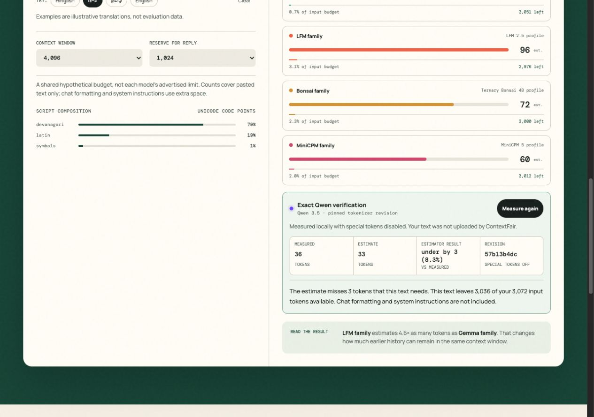

<h1 align="center">ContextFair</h1>

**Compare token estimates, reserve room for a reply, and check the result against a pinned Qwen tokenizer.**

[Hosted prototype (owner access required)](https://contextfair.om-exp99.chatgpt.site)

Browser-local text analysis. No inference API or app analytics. Fonts, libraries, and tokenizer files load from external hosts; hosted prototype is owner-private.

By Om Patnaik · repository created October 2026.

[](LICENSE)



## Install

| Platform / path | Start here |
| --- | --- |
| Local browser | `python3 -m http.server 4173 --bind 127.0.0.1 --directory dist` |
| Hosted prototype | [Open with owner access](https://contextfair.om-exp99.chatgpt.site) |

Open http://127.0.0.1:4173, select हिन्दी, and adjust the reply reserve. Built-in example messages let you try it without entering personal text. Exact counting first downloads about 19 MB of tokenizer assets plus library code.

```bash
python3 -m http.server 4173 --bind 127.0.0.1 --directory dist
```

## Why

You need room for conversation history and a response, but a character-count rule can misestimate multilingual text. ContextFair compares five estimate profiles with one explicitly requested exact Qwen count. It does not prune history or measure complete provider chat prompts.

## Explore the budget

A 4,096-token scenario with 1,024 reserved for a reply leaves 3,072 for input. Change the reserve and compare the remaining space; this is a hypothetical shared window, not a model capability claim.

## Measure the same text

Exact counting uses a pinned tokenizer in a Web Worker with special tokens disabled. Editing the text invalidates the old result. The documented Hindi demo measured 36 tokens against an estimate of 33; that is an integration observation, not a general accuracy result.

## Notes from building it

I moved exact counting into a worker to keep it off the interface thread. Changed text clears the old measurement so a stale result cannot appear current. I would next add chat-template accounting and more exact tokenizers, with separate evidence for each.

## Commands

```bash
python3 -m http.server 4173 --bind 127.0.0.1 --directory dist  # run the app
node --test tests/core.test.mjs                             # run product tests
```

## Verify it yourself

```bash
node --test tests/core.test.mjs
```

Tests cover script buckets, Unicode code points, budget arithmetic, and result explanations. Browser checks dated October 18 are recorded in [the page review](docs/PAGE_REVIEW.md); the Node tests do not download or execute the exact tokenizer.

## Credits, license and pointers

Estimator adapted from Chirag Patnaik’s [LocalMind](https://github.com/NakliTechie/LocalMind); runtime uses Transformers.js and Qwen tokenizer assets. Application work by Om Patnaik for EurekaDev 2026, assisted by Codex. [MIT](LICENSE) · [Third-party notice](NOTICE.md).

[Full setup, original notes, and project history](README-DETAILS.md).
