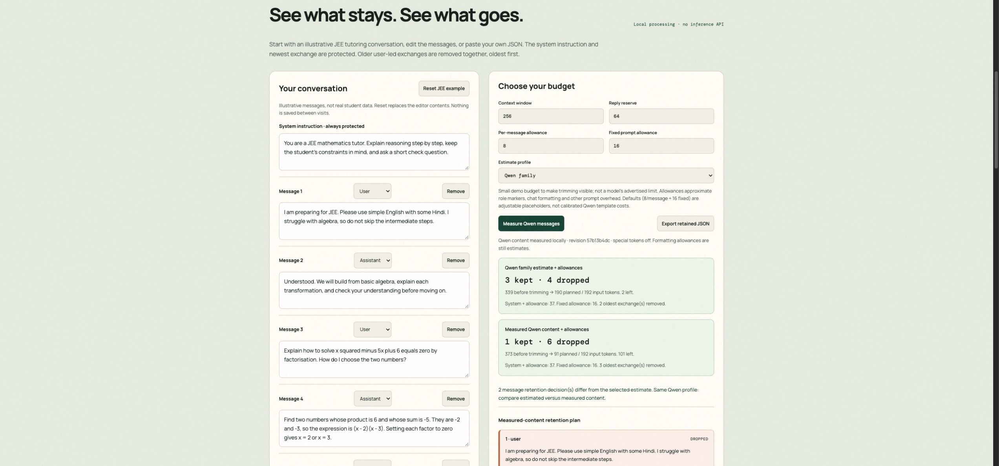

<h1 align="center">ContextFair</h1>

**See which AI chat messages fit, which get dropped, and why—then export the retained conversation.**

[Open the public demo](https://ompatnaik.com/contextfair/) · [Demo script](docs/DEMO_SCRIPT.md) · [Devpost description](docs/DEVPOST_DRAFT.md)

Hosted on GitHub Pages at **ompatnaik.com/contextfair/**. Runs in a normal modern browser—no sign-in, API key, or installation required. Entered text is processed locally; fonts, libraries, and tokenizer files load from external hosts.

By Om Patnaik · EurekaDev 2026 · Coding Track · Computer Science + AI.

[](LICENSE)



## Try it now

Use the **[live conversation planner](https://ompatnaik.com/contextfair/#planner)**.
No installation or local server is needed.

1. Start with the illustrative JEE conversation: window **256**, reply **64**,
   per-message allowance **8**, fixed allowance **16**.
2. The Qwen estimate keeps **3 messages** and drops **4**. Click **Measure Qwen
   messages**: the measured-content plan keeps **1** and drops **6**.
3. Raise the window to **320**: both retain **3**. The measured-content plan uses
   **209 of 256** input tokens, including your formatting allowances.
4. Inspect each message's status and export the retained JSON.
5. Set the window to **100**: protected content cannot fit, so export is blocked.

The system instruction and newest user-led exchange are protected. The oldest
complete exchanges are removed first; messages are not erased from the editor.
Edit or import your own conversation (up to 100 messages / 100,000 characters).
No chat data is uploaded or saved between visits.

**Measurement scope:** Qwen counts individual message content exactly, then the
planner adds adjustable formatting allowances. It does not tokenize a complete
chat template. The default allowances are placeholders, not calibrated model
costs; validate the final prompt in your target application.

## Developer setup (optional)

Requirements: Git, Python 3, and a modern browser supporting JavaScript modules and Web Workers. No package installation or build step is needed.

```bash
git clone https://github.com/OmTheLast/contextfair.git
cd contextfair
python3 -m http.server 4173 --bind 127.0.0.1 --directory dist
```

Open [http://127.0.0.1:4173](http://127.0.0.1:4173/). Serve over HTTP rather than opening the HTML file directly. First-time exact counting needs internet access and downloads about 19 MB of tokenizer assets plus library code—not AI model weights.

## Why

While working on a JEE learning model intended to run in the browser, Om began
investigating tokenizer download size and multilingual token counts. ContextFair
turns that investigation into a practical conversation planner: inspect which
messages a budgeting policy would drop, compare estimates with measured content,
and export a retained history. It does not call a model or measure complete
provider chat prompts. The research study remains separate.

## Optional token-lab walkthrough

1. Choose **हिन्दी**.
2. Set context window to **4,096** and reply reserve to **1,024**: **3,072** input tokens remain.
3. Click **Measure exact Qwen count**. The built-in example measures **36**, compared with **33 estimated**: **3,036** input tokens remain.
4. Increase the reserve to **2,048**: **2,012** tokens remain after the measured text.
5. Edit the input: the old exact result disappears until you measure again.

These are results for one illustrative input, not a general accuracy score. The shared window is a hypothetical scenario, not each model's advertised limit.

## How it works

Plain HTML, CSS, and JavaScript provide the interface. The estimator counts Unicode code points by script bucket, applies model-specific weights, adds them, and rounds up. Exact Qwen counting runs on demand through Transformers.js in a background Web Worker using a fixed tokenizer revision.

For the Hindi example, the weighted sum is **32.342 → 33 estimated tokens**. See the [worked calculation and reproducible source check](README-DETAILS.md#estimator-calculation-and-evidence), [architecture](README-DETAILS.md#how-it-works), and [verification limits](README-DETAILS.md#verification-and-limits-of-the-evidence).

## Verify it yourself

Node.js 18+ is needed only for tests:

```bash
node --test tests/core.test.mjs
```

Seventeen tests cover script buckets, Unicode code points, budget arithmetic,
whole-exchange retention, protected-content overflow, JSON import and result
explanations. They do not download or execute the exact tokenizer. Browser
checks additionally cover measured counts and the downloaded retained JSON.
The [earlier token-lab review](docs/PAGE_REVIEW.md) is historical.

## Limits and next steps

Only Qwen has exact measurement; the five comparison rows remain estimates. Counts exclude chat templates, special tokens, system instructions, tools, and provider billing. Token count does not measure model quality or prove fairness. Asset downloads mean offline operation is not guaranteed.

Next: more exact tokenizers, explicit chat-template budgeting, and optional
pinned older messages. Current retention is oldest-first, not semantic ranking.

## Credits, license and pointers

Estimator adapted from Chirag Patnaik's [LocalMind](https://github.com/NakliTechie/LocalMind); runtime uses Transformers.js and Qwen tokenizer assets. Application work by Om Patnaik for EurekaDev 2026, assisted by Codex. [MIT](LICENSE) · [Third-party notice](NOTICE.md).

[Detailed setup, methods, evidence, and limitations](README-DETAILS.md) · [Product/research boundary](docs/PRODUCT_BOUNDARY.md) · [Judge guide](docs/JUDGE_GUIDE.md)
