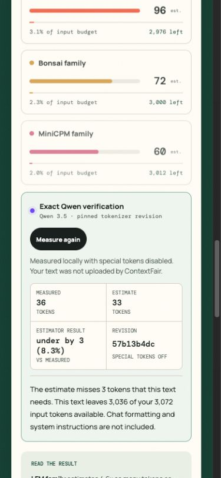

# Page review — October 18, 2026

Reviewed the deployed presentation at https://contextfair.om-exp99.chatgpt.site/.
This round replaces the previous round's outstanding visual-review limitation
for the specific flows below; it is not an exhaustive browser/accessibility audit.

## Verdict

Ready for a demo rehearsal. The central interaction is clear and works in the
checked desktop and mobile views. The strongest story is the move from an
estimate to a measured count and its effect on available conversation space.

## What works

- The hero explains the task and links directly to the walkthrough.
- The three steps explain text, budget, and verification before the controls.
- Estimates stay labelled; the measured panel is visually distinct.
- Remaining-space prose updates when the reply reserve changes.
- Editing input hides stale measurements and their explanations.
- The footer method button remains accessible on mobile; the dialog scrolls.
- Screenshots at 1280x900 and 390x844 show legible measured results. The mobile
  view has no horizontal overflow. No warnings/errors appeared in captured logs.

## Issues and presentation choices

1. **Script bucket wording needs clarification.** The Hindi sample shows
   “Latin 19%” because the estimator groups spaces with Latin. The source's
   `classIndex` explicitly assigns ASCII space to class 0. This is not a
   detected language percentage. Suggested future copy: “Estimator character
   buckets,” and “Latin + spaces” for that bucket. Do not narrate this chart as
   language detection. No estimator weights need to change to clarify the label.
2. **Mobile requires scrolling between input and result.** The layout fits, but
   desktop is better for the recording. Scroll deliberately to the measured
   panel and pause so its counts can be read.
3. **The opening promise is broader than the prototype's impact evidence.**
   Explain that ContextFair helps inspect token budgets; do not claim it fixes
   language inequality, saves measured money, or prevents all truncation.
4. **First-use download can interrupt pacing.** Warm the tokenizer before
   recording, disclose the initial download, and keep an authentic recording of
   the actual measurement. Do not imply the first load is instantaneous.

## Rehearsal values observed in the deployed app

Built-in हिन्दी text:

> यदि टोकन की गिनती गलत हो, तो उपयोगी बातचीत का इतिहास बिना चेतावनी हट सकता है।

| Item | Observed value |
| --- | --- |
| Five estimates (Qwen / Gemma / LFM / Bonsai / MiniCPM) | 33 / 21 / 96 / 72 / 60 |
| Measured Qwen count | 36 |
| Qwen estimate error | 3 tokens under / 8.3% |
| 4096 window, 1024 reply reserve | 3072 available; 3036 left after measured input |
| 4096 window, 2048 reply reserve | 2048 available; 2012 left after measured input |
| After editing text | Stale; result and explanation hidden |

Counts are specific to this text and pinned tokenizer, with special tokens off.
They are demonstration observations, not an independent accuracy benchmark.
The earlier 35-versus-43 reference check uses different text.

## Captured views

No application code or hosting configuration was changed during this review.
